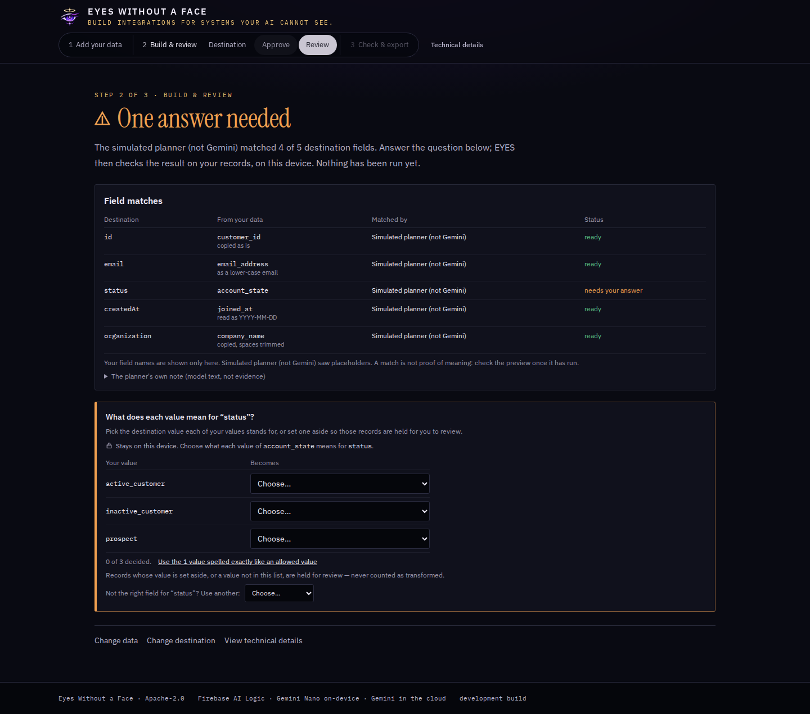
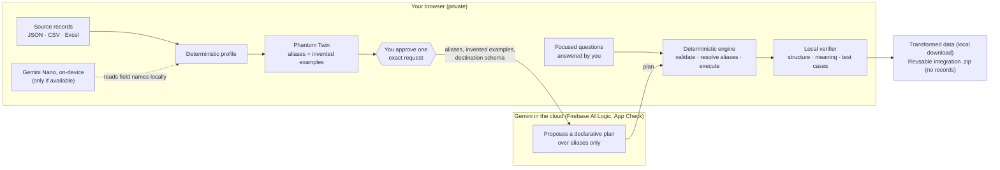

<div align="center">


# Eyes Without a Face

**Build integrations for systems your AI cannot see.**

A privacy-first, AI-assisted integration builder powered by Gemini Nano, Gemini in the cloud and Firebase AI Logic.

[Live demo](https://eyes-without-a-face-b7281.web.app) · [How it works](#how-it-works) · [Documentation](docs/README.md)


</div>

---

## The problem

You need to move records from a private system into a new one. A cloud model could write the field mapping in seconds, but the records (names, emails, internal notes) are not allowed to leave your machine. Pasting "just a few rows" into a chat is exactly the leak you were trying to avoid. So integrations get hand-written, slowly, by the people who are allowed to see the data.

EYES lets a cloud model help design the integration **without being shown the records**. It then checks the result locally and hands you a package that runs outside the app.

## How it works

| | Stage | What happens |
| --- | --- | --- |
| **1** | **Add your data** | Upload JSON, CSV or Excel, or try a fictional example. Choose a destination schema (an example, or your own JSON Schema). Everything is parsed in the browser. |
| **2** | **Build & review** | EYES prepares a fictional stand-in for your data (the *Phantom Twin*) and shows you the exact request. After you approve it, Gemini proposes how destination fields get their values. EYES shows each match and asks a focused question where it is unsure. |
| **3** | **Check & export** | The mapping runs on your records, on your device. EYES reports structure and meaning separately, lists what needs review, and lets you download the transformed data and a reusable integration package. |

<p align="center">
  
  <br />
  <sub>Build &amp; review on a local build with fictional data. The planner here is the labelled simulated test adapter, not Gemini.</sub>
</p>

## Why EYES is different

- **On-device understanding.** Where Chrome's built-in model is available, Gemini Nano reads your field names privately, through Firebase AI Logic in `ONLY_ON_DEVICE` mode. When it is not available, EYES says so and uses deterministic analysis. It never pretends.
- **Phantom Twin.** Every source field becomes a meaningless alias (`f_01`, …) with invented example values. The binding between alias and real field never leaves the page.
- **Explicit cloud disclosure.** Nothing reaches Gemini until you approve one exact request: you can see what is sent, what stays, and the request text itself. One approval covers one request. EYES never falls back from on-device to cloud on its own.
- **Ranked correspondence suggestions.** Gemini lists the likely source for each destination field. The on-device matcher, which does see the real field names, checks those picks.
- **Human clarification.** When the two disagree, or a value needs a business meaning (what does `inactive_customer` become?), EYES asks one targeted question. The best candidates come first, with *choose another field*, *combine fields* and *no matching field*. A suggestion is never treated as a decision.
- **Deterministic transformation and verification.** The model proposes declarative operations from an eight-operation allowlist. It cannot run code. A local engine executes them, and a local verifier judges the outcome. Meaning counts as verified only from your own answers.
- **Portable output.** The reusable integration is a ZIP that runs with plain Node.js 22: the mapping, the destination schema, the app's own engine and a runner, all SHA-256 pinned. It contains no records, no field names and no alias bindings.

## Architecture



- **Leaves the browser, after your approval:** field aliases and their types, invented example values, the destination field names and sanitized descriptions, and any category names you choose to share, field by field.
- **Never leaves the browser:** your records, your real field names, the alias bindings, the reserved test cases, and failure values.
- **A Phantom Twin reduces disclosure; it does not anonymize.** Field counts, formats and shared category names can still say something about the source system. That is why you review the exact request. The Firebase SDK also adds App Check tokens and normal transport metadata.

Details: [system architecture](docs/architecture/system.md) · [security model](docs/security/README.md) · [contracts](docs/contracts/README.md).

## What has been validated

Every number below comes from a linked, committed report. The kinds of evidence are kept apart on purpose.

| Kind | Result | Source |
| --- | --- | --- |
| **Deterministic tests** (no model) | Lint, typecheck and build pass. Unit, contract, privacy, evaluation and browser E2E suites pass at the Sprint 19 head; counts are in the Sprint 19 report. | [Sprint 19](docs/sprints/sprint-19.md) |
| **Real-model evaluation** (pre-registered, fresh independently written holdout, 18 completable scenarios) | Complete, correct integrations rose from **1 / 18 to 9 / 18**. Incorrect transformed records fell from 0.90 to **0.39**. **0** falsely verified records, **0** invented values, **0** privacy findings, **0** unauthorized requests. The app's questions were answered by a simulated user that answers truthfully from the ground truth. | [Sprint 18F confirmatory run](docs/evaluation/sprint-18f-confirmatory.md#results) |
| **Production smoke tests** on the public URL (release `65cbf0e`, production App Check, no debug token) | 19 / 19 deterministic checks. One real hybrid run: Gemini Nano on-device, then one approved Gemini request with 0 leaked private terms, outcome *partially verified*, export verified outside the app. | [Production evidence](docs/evidence/production/65cbf0eaa71f/failures.md) |
| **End-to-end semantic correctness** | **Not established in general.** About half of hard, unfamiliar integrations still need human review. The verifier reports *Structure verified* rather than *Integration ready* unless meaning was verified for every field. | [Sprint 18F report](docs/sprints/sprint-18f.md) |

## Known limitations

EYES is an **assisted mapper**, not a reliable autonomous integration generator.

- **About half of hard integrations need review.** The usual cause is a field where Gemini and the local matcher agree on the wrong source. EYES cannot detect that, so it does not claim the meaning is verified.
- **Questions have a cost.** On the benchmark, EYES asked about 0.74× as many questions as mapping by hand, against a 0.6× target. Milestone 1 (≥ 70 % complete integrations) was **not met**.
- **Provider reliability.** About 15 % of cloud requests hit provider-side errors or timeouts. Recovery is one new request that you approve again; there is no automatic retry.
- **Scope.** Up to 250 records and 64 columns per source. Locale-formatted numbers and dates (`1234,50`, `15.03.2026`) are not converted. EYES writes nothing to the destination system.
- **Gemini Nano** needs desktop Chrome with the built-in Prompt API and a downloaded model ([compatibility](docs/setup/browser-compatibility.md)).
- **Not done yet:** independent usability sessions and a manual screen-reader pass ([protocol](docs/usability/README.md)).

## Getting started

**Requirements:** Node.js 22 or later, pnpm 10 (`packageManager: pnpm@10.28.0`). The Excel parser is installed from the SheetJS CDN (`cdn.sheetjs.com`), so `pnpm install` needs access to it.

```bash
pnpm install
pnpm dev            # http://localhost:5173
```

**No Firebase configuration is needed** to run the app. Without it, you can complete the whole journey, including export, on your device: the Phantom Twin, the request review and a mapping you build from your own answers. On-device and cloud AI are then shown as unavailable, never simulated.

**To enable real inference:**

1. Copy `.env.example` to `.env.local` and fill in the public Firebase web config ([Firebase setup](docs/setup/firebase.md)).
2. **Cloud.** App Check is enforced. On `localhost`, set `VITE_APP_CHECK_DEBUG=true` and safelist the debug token ([App Check setup](docs/setup/app-check.md)). The hosted build uses reCAPTCHA Enterprise.
   Then set `VITE_ENABLE_CLOUD_INFERENCE=true`.
3. **On-device.** Set `VITE_ENABLE_ON_DEVICE_INFERENCE=true`. Gemini Nano needs desktop Chrome with the Prompt API; some hardware needs experimental flags ([compatibility](docs/setup/browser-compatibility.md)).

**Testing and builds:**

| Command | Purpose |
| --- | --- |
| `pnpm test:all` | Lint, typecheck, unit, contract, privacy and evaluation tests, build, and deterministic Playwright E2E (no model calls) |
| `pnpm test:e2e` | Browser E2E only, against a local dev server with all inference disabled |
| `pnpm build:release` | Production build for Hosting. It forces App Check debug off, stamps the Git SHA and verifies `dist/`. Deploy only this output. |
| `pnpm test:live` | Opt-in suite against real Firebase/Gemini ([guide](docs/testing/playwright-live.md)). It uses inference quota; never run it in CI. |

Deployment is approval-gated: [docs/deployment.md](docs/deployment.md).

**Running an exported integration:**

```bash
unzip eyes-integration-*.zip && cd eyes-integration-*/
node run.mjs verify                                             # hashes, contract, fixture replay
node run.mjs bindings-template --out ../bindings.local.json     # map f_NN → your field path
node run.mjs run --input ../records.json --bindings ../bindings.local.json --out ../results.json
```

The package status is computed, never asserted: `VERIFIED`, `VERIFIED_WITH_EXCEPTIONS`, or a confirmed `DRAFT`, which is not production-ready. `VERIFIED` is a structural status ([export contract](docs/contracts/export.md)).

## Repository structure

| Path | Contents |
| --- | --- |
| `src/app/` | React UI. The guided flow is in `src/app/guided/`; the technical view (`/#technical`) shows the full 17-stage runtime |
| `src/domain/mapping/` | The deterministic mapping engine (no React, Firebase or browser APIs) |
| `src/sources/` | Source Adapter Layer: JSON, CSV, Excel and a read-only REST snapshot, normalized to one shape |
| `src/twin/`, `src/phantom/`, `src/privacy/` | Phantom Twin, disclosure payloads and privacy checks |
| `src/inference/` | Firebase AI Logic adapters: `ONLY_ON_DEVICE` (Nano) and `ONLY_IN_CLOUD` (Gemini) |
| `src/plan/`, `src/proposal/`, `src/matching/` | Plan validation, proposal conversion and the on-device field matcher |
| `src/verification/`, `src/semantics/` | Local verdicts and semantic verification |
| `src/export/` | Portable package builder and the export privacy scan |
| `tests/` | Unit, contract, privacy, evaluation, E2E, live and production suites |
| `docs/` | Architecture, contracts, decisions (ADRs), sprint reports, evaluation and evidence |

## Contributing

See [CONTRIBUTING.md](CONTRIBUTING.md) for setup and checks, and [AGENTS.md](AGENTS.md) for the architecture and privacy rules every change must keep. Report security issues as described in [SECURITY.md](SECURITY.md).

## License

[Apache-2.0](LICENSE). The emblem artwork was supplied by the owner; see [docs/branding/README.md](docs/branding/README.md).

## Hackathon

EYES is an entry in Google's **#BuildHybridAI 2026** hackathon. It uses **Firebase AI Logic** for both sides of the hybrid design: Gemini Nano on-device (`ONLY_ON_DEVICE`) for private understanding, and Gemini in the cloud (`ONLY_IN_CLOUD`, App Check enforced) for reasoning over what you approve.

The project started **before** the Submission Period opened (2026-11-11 21:30 UTC). Sprints 0–4 are pre-existing work: the contracts, the first adapters, the mapping engine, the first Phantom Twin and the first real Nano and Gemini runs. Everything from Sprint 5 on was built during the period, including semantic verification, portable export, the guided flow, the public deployment and the evaluation program. Commit dates are original and were never rewritten. Commit-level disclosure: [docs/hackathon-history.md](docs/hackathon-history.md) · Rules and compliance: [docs/hackathon-requirements.md](docs/hackathon-requirements.md).

All data in the demo is fictional.
