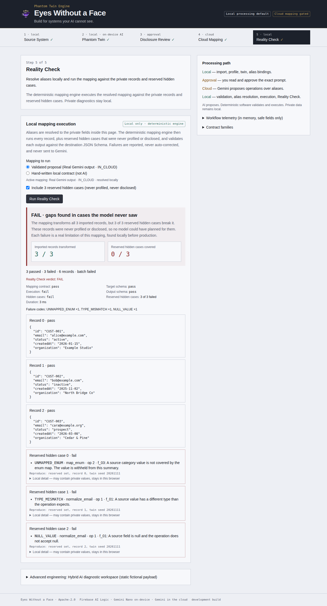

# Eyes Without a Face

**Build integrations for systems your AI cannot see.**

A privacy-aware integration studio for the Google #BuildHybridAI 2026 hackathon. It lets a cloud model design a data integration for a private system **without being shown that system's records**, proves the result locally, and exports it as a package that runs outside the app.



## The problem

You need to move customer records from a private CRM into a new system. Gemini could write the field mapping in seconds, but the records (names, emails, internal notes) are not allowed to leave your machine. Pasting "just a few rows" into a chat is exactly the leak you are trying to avoid.

## The mechanism: a Phantom Twin

```text
Private JSON ──▶ Phantom Twin ──▶ Disclosure Review ──▶ Gemini (cloud) ──▶ Reality Check
 this browser    this browser      you approve one        proposes a          this browser
                 + Gemini Nano     exact request          declarative         runs it on the real
                   on-device                              mapping             records + hidden cases
```

1. **Source (local).** The JSON is profiled by deterministic code in the browser. Nothing is uploaded.
2. **Phantom Twin (local, on-device AI).** Every field becomes a meaningless alias (`f_01`…) with fictional example values. Gemini Nano, running on-device through Firebase AI Logic (`ONLY_ON_DEVICE`), may suggest field roles from the *synthetic* samples. The alias-to-field bindings never leave the page.
3. **Disclosure Review (you).** The app shows the exact application prompt it would send, with its SHA-256. Approval is bound to that prompt, the destination model and one request id. One approval authorizes one request.
4. **Cloud Mapping (Gemini in the cloud).** Firebase AI Logic (`ONLY_IN_CLOUD`, App Check enforced) sends only the approved payload. Gemini returns a declarative mapping over aliases using an eight-operation allowlist. It cannot execute code.
5. **Reality Check (local, deterministic).** The proposal is validated against the canonical Mapping Contract, aliases are resolved locally, and the engine runs it against the private records **and against reserved hidden cases that were never profiled or disclosed**. A semantic verifier then checks what the mapping *means*, and you may approve one blind revision.
6. **Export Integration (local).** Download a ZIP that runs with plain Node 22: the alias-level mapping, destination schema, fictional fixtures, a value-free report, the acceptance policy and the app's own engine, all SHA-256 pinned. No records, field names or alias bindings. You bind aliases to your fields in your own environment ([docs/contracts/export.md](docs/contracts/export.md)).

**AI proposes. Deterministic code validates and executes.** There is no automatic fallback between on-device and cloud. If a model is unavailable, the app says so and offers a manual path, labeled as manual.

### What the cloud does and does not see

| Leaves the browser (after your approval) | Never leaves the browser |
| --- | --- |
| Field aliases, generated descriptors, fictional example values, category labels you choose to disclose, a minimal destination description | Source records, original field names, alias bindings, dataset name, reserved hidden cases, failure values |

A Phantom Twin **reduces** disclosure; it does not make data anonymous. Structure, field counts, value formats and any category labels you disclose can still reveal something about the source system. That is why you review the exact request. The app controls the *application payload*; the Firebase SDK still adds App Check tokens, transport metadata and normal HTTP headers.

## What the demo shows

Using a fictional 3-record CRM and a fictional helpdesk destination:

- Gemini Nano classifies the six twin fields on-device: `inferenceSource = ON_DEVICE`, with no cloud request.
- Gemini in the cloud proposes a five-operation mapping: `inferenceSource = IN_CLOUD`. The proposal passes strict contract validation unchanged.
- Locally, all **3 / 3 imported records** transform into valid destination records.
- **0 / 3 reserved hidden cases** are covered: an unseen enum value (`UNMAPPED_ENUM`), a non-string email (`TYPE_MISMATCH`) and a null email (`NULL_VALUE`). The verdict is **FAIL · gaps found in cases the model never saw**. The point of the product is that this discovery happens before production, and without showing the model the data.

Walkthrough script: [docs/demo/README.md](docs/demo/README.md).

## Evidence

Real inference through Firebase AI Logic on Chrome 157 (Linux, AMD Strix Halo) with experimental on-device flags, from the Sprint 5 live suite. Details and caveats are in [docs/sprints/sprint-5.md](docs/sprints/sprint-5.md).

| Check | Result |
| --- | --- |
| On-device Gemini Nano (`ONLY_ON_DEVICE`), guided twin step | `ON_DEVICE`, 6 / 6 fields, schema-valid, 0 cloud requests (3 / 3 runs) |
| Cloud Gemini (`ONLY_IN_CLOUD`, App Check enforced), guided mapping | `IN_CLOUD` in about 2 s, proposal valid unchanged (3 / 3 runs) |
| Private terms in the real `generateContent` request body | 0 |
| Sprint 9 live hero journey (Nano → Gemini → one revision → export → `node run.mjs verify`), 5 runs | 3 `ACCEPTED`, 1 `HUMAN_REVIEW_REQUIRED` (exported as DRAFT), 1 invalid initial proposal rejected; 4 / 4 exports verified; 0 private terms in 9 request bodies |
| On-device reliability, 10 cold + 10 warm browser runs | 19 / 20 first try, 20 / 20 after one user retry, 0 cloud fallbacks |
| Sprint 10 live requalification of the new CONNECT / OBSERVE / OUTCOME journey, 1 run | Nano 6 / 6 on-device; Build Integration sent 0 requests; Gemini proposal valid; revision `ACCEPTED`; export `VERIFIED_WITH_EXCEPTIONS`, `node run.mjs verify` exit 0; 0 private terms in 2 request bodies |
| Sprint 11 live requalification of the CONNECT-first sequence, 1 run | Nano 6 / 6 on-device in CONNECT before any request existed; 0 invalidated approvals; Gemini proposal valid in 2.4 s; revision `ACCEPTED`; export `VERIFIED_WITH_EXCEPTIONS`, `node run.mjs verify` exit 0; 0 private terms in 2 request bodies |
| Deterministic suites (Sprint 11 head) | 251 unit · 43 contract · 69 privacy · 62 evaluation · 113 Playwright E2E |

## Run it

```bash
pnpm install
pnpm dev          # http://localhost:5173
```

The app runs **without any Firebase configuration**. You can complete the whole walkthrough, including export, with deterministic profiling, the Phantom Twin, the disclosure review and a hand-written mapping contract. On-device and cloud AI stay visibly unavailable, never simulated.

To enable real inference:

1. Copy `.env.example` to `.env.local` and fill in the public Firebase web config ([docs/setup/firebase.md](docs/setup/firebase.md)).
2. **Cloud:** App Check is enforced. On `localhost` use the debug provider and safelist the token ([docs/setup/app-check.md](docs/setup/app-check.md)). The hosted build uses reCAPTCHA Enterprise.
3. **On-device:** Gemini Nano needs desktop Chrome with the Prompt API and a downloaded model. Some hardware needs experimental flags ([docs/setup/browser-compatibility.md](docs/setup/browser-compatibility.md)).

| Command | Purpose |
| --- | --- |
| `pnpm test:all` | Lint, typecheck, unit, contract, privacy, evaluation, build, deterministic Playwright E2E |
| `pnpm build:release` | Production build for Hosting: forces App Check debug off, stamps the Git SHA, verifies `dist/` |
| `pnpm test:live` | Opt-in real Firebase/Gemini suite ([docs/testing/playwright-live.md](docs/testing/playwright-live.md)); never in CI |

## Exported package

```bash
unzip eyes-integration-*.zip && cd eyes-integration-*/
node run.mjs verify                       # hashes, canonical contract, fixture replay
node run.mjs bindings-template --out ../bindings.local.json   # then fill f_NN → your field path
node run.mjs run --input ../records.json --bindings ../bindings.local.json --out ../results.json
```

The package status is computed, never asserted: `VERIFIED`, `VERIFIED_WITH_EXCEPTIONS` (quarantine within policy, listed), or a confirmed `DRAFT`, which is not production-ready.

## Status

Sprint 11 is an acceptance sprint. OBSERVE now leads with the current stage, the last completed stage and the one next action, and groups the 17 stages into five phases that collapse on phones. On-device interpretation moved into CONNECT, before the cloud request is prepared. A change after preparation explains why the request was cleared. OUTCOME leads with one verdict that never says "verified" for meaning it did not check. Export ends with the five real runner steps. The **Privacy Boundary** band shows source → twin → your approval → cloud → verified outcome from state alone. See [docs/sprints/sprint-11.md](docs/sprints/sprint-11.md). Independent usability testing, a manual screen-reader pass and the hosted deployment are still **open** (owner action).

Sprint 10 reorganizes the product around three moments:

- **CONNECT** — choose a source and a destination; **Build Integration** runs locally and stops at your approval.
- **OBSERVE** — a Live Intelligence Runtime shows each of 17 stages where it actually ran: this browser, your approval (the halo), or Gemini Cloud. Every status is derived from real state.
- **OUTCOME** — the verdict with structure and meaning kept apart, before/after, the privacy outcome, and Export.

The new **Black Halo** art direction is derived from the emblem. No gate, contract or engine changed. See [docs/sprints/sprint-10.md](docs/sprints/sprint-10.md) and [ADR 0011](docs/decisions/0011-experience-architecture-black-halo.md).

Sprint 9 adds **portable export**, provider-failure guidance with explicit fresh-approval recovery, and a runtime preflight ([docs/sprints/sprint-9.md](docs/sprints/sprint-9.md)), on top of Sprint 7 **Blind Integration** and Sprint 8 **Semantic Verification**. Sprint 9 live: 3 of 5 real hero runs ended `ACCEPTED` and exported, and 4 of 4 exported packages verified with plain `node`. Judge summary: [docs/submission/evidence.md](docs/submission/evidence.md).

A local verifier checks what a mapping *means*, not only its structure, against constraints the owner declared or that local records prove. You can then approve one revision request that tells Gemini what is wrong, and optionally the approved constraint, never the records.

Sprint 8 real-model benchmark (preliminary, 5 trials, frozen fresh holdout, every number replayed offline):

- **Detection.** The verifier flagged every schema-valid but wrong holdout output of real Gemini mappings: CRM 20/20, support 36/36, 0 false alarms.
- **Correction.** Two real blind revisions corrected the meaning on the independent holdout with 0 regressions: support 0 → 6 and CRM 1 → 9 correct transformations, of 10.
- **What was not shown.**
  - A deterministic local patch using the same approved constraint did as well (9) or better (7), so the model's advantage over simpler alternatives is unproven.
  - Gemini Nano added no measurable value.
  - 5 of 8 revision requests timed out at the provider.

The hosted deployment and public release are gated on owner approval ([docs/deployment.md](docs/deployment.md)); nothing is deployed yet. No independent usability test has been run ([docs/usability/README.md](docs/usability/README.md)).

## Project

- Architecture: [docs/architecture/system.md](docs/architecture/system.md) · Security model: [docs/security/README.md](docs/security/README.md) · All docs: [docs/README.md](docs/README.md)
- Built during the hackathon period. See [docs/hackathon-history.md](docs/hackathon-history.md).
- Contributing: [CONTRIBUTING.md](CONTRIBUTING.md) · Security reports: [SECURITY.md](SECURITY.md)
- License: [Apache-2.0](LICENSE). The emblem artwork is owner-supplied; see [docs/branding/README.md](docs/branding/README.md).
