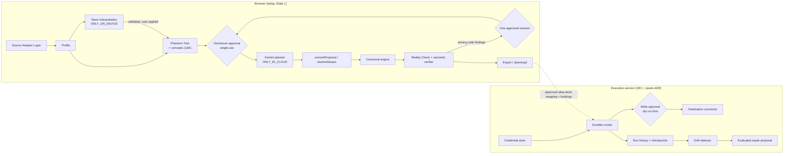

# Master Transformation Assessment — from transformation engine to AI integration engineer

Date: 2026-11-16 · Baseline: `main` @ `82400dd` (accepted production release `c7220768bed9`, PRODUCTION_ACCEPTED, Sprint 17A) · Decisions: [ADR 0015](../decisions/0015-ai-integration-engineer-program.md), [ADR 0016](../decisions/0016-concept-bearing-phantom-twin.md)

**North star.** Connect your systems → tell EYES what you want → EYES builds and verifies the integration → approve → it works.

**Where we are:** State 1 is partial (AI-generated transformations with honest verification). There are no connected integrations (State 2) and no governed platform (State 3). This document does not describe any later-state capability as shipped.

---

## A. Current architecture: what is reused, what changes

Every entry was verified against code and tests on `82400dd`.

**Test baseline on `82400dd`:**

- lint and typecheck pass;
- unit 386, contracts 43, privacy 99, evaluation 84;
- build passes;
- E2E 162.

All green.

### Capability inventory

| Area | Capability | Status | Evidence |
| --- | --- | --- | --- |
| Engine | Mapping DSL (8 ops), `executeMapping(Batch)`, path safety | EXISTING_AND_VALIDATED | `src/domain/mapping/`, `tests/unit/mapping-*.test.ts`, `tests/contracts/mapping-execution.test.ts` |
| Proposal boundary | `convertProposal` → `resolveAliases`, no repair | EXISTING_AND_VALIDATED | `src/proposal/`, frozen (Sprint 8 manifest) |
| Phantom Twin | Aliases, role descriptors, synthetic examples, collision checks | EXISTING_AND_VALIDATED | `src/phantom/`, `tests/unit/phantom-twin.test.ts` |
| Phantom Twin | Business meaning that separates confusable fields | **EXISTING_BUT_LIMITED** (new in 18A, deterministic only) | `src/phantom/concepts.ts`, ADR 0016 |
| Disclosure | Allowlist projection, exact-prompt preview, single-use approval bound to the outbound hash, ledger | EXISTING_AND_VALIDATED | `src/twin/`, `tests/privacy/*` |
| Cloud planner | Gemini `gemini-3.5-flash-lite`, `ONLY_IN_CLOUD`, per-operation response schema | EXISTING_BUT_LIMITED: schema-valid but semantically wrong mappings (Sprint 8); incomplete answers possible (17A); 10/30 provider failures in Sprint 8 | `src/inference/firebase-live.ts`, `docs/sprints/sprint-8.md` |
| On-device AI | Nano role and date-order suggestions, validated against the profile, user-applied | EXISTING_BUT_LIMITED: neutral downstream (Sprint 12); can only change role and date order | `src/private-semantics/semantics.ts`, `docs/evaluation/sprint-12-nano-value.md` |
| Verification | Reality Check, versioned acceptance policy, outcome classes | EXISTING_AND_VALIDATED | `src/verification/`, `tests/unit/outcomes*.test.ts` |
| Semantic verification | Trusted constraints (user-declared, observation), detection of date-order and priority inversion | EXISTING_AND_VALIDATED (CRM 20/20, support 36/36, 0 false alarms in Sprint 8) | `src/semantics/` |
| Repair loop | One approved blind revision, ground-truth-blind decision rule | EXISTING_BUT_LIMITED (n = 2 delivered; P control matched it) | `src/revision/` |
| Clarification | Target-first per-field questions, category translations as trusted constraints | EXISTING_AND_VALIDATED (local path) | `src/app/guided/field-plan.ts`, `tests/unit/sprint15-field-plan.test.ts` |
| Clarification | AI-chosen *narrow* questions ("which id identifies the customer?") | NOT_IMPLEMENTED | — |
| Guided UX | Your data → Destination → Result, recovery diagnosis, preflight block | EXISTING_AND_VALIDATED | `src/app/guided/`, `tests/e2e/guided.spec.ts`, `sprint17a.spec.ts` |
| Guided UX | One AI-first CTA | PARTIALLY_IMPLEMENTED: "Build integration" is primary, but "Build on this device" can sit beside it (`DestinationStep.tsx:369-374`) | — |
| Sources | JSON, CSV, XLSX, one read-only REST GET (bearer token in memory) | EXISTING_AND_VALIDATED / REST EXISTING_BUT_LIMITED (no pagination, no OAuth) | `src/sources/`, `tests/unit/source-adapters.test.ts`, `rest-connector.test.ts` |
| Export | Portable ZIP with the same engine, provenance-aware privacy scan, eligibility | EXISTING_AND_VALIDATED | `src/export/`, `tests/contracts/export-clean-room.test.ts` |
| Workflow state | One `WorkspaceState` + pure `deriveRuntime` | EXISTING_AND_VALIDATED | `src/app/workspace-state.ts`, `runtime-model.ts` |
| Destination writes | Any connector writing to an external system | NOT_IMPLEMENTED (no POST/PUT in `src`) | — |
| Persistence | Saved integrations, run history across sessions | NOT_IMPLEMENTED (no storage APIs in `src`) | — |
| Versioning and rollback | Mapping versions with approval records | PARTIALLY_IMPLEMENTED (`mappingVersion` string, content-hashed export id only) | `src/export/package.ts` |
| Scheduling, monitoring | Triggers, retries, dead-letter, dashboards | NOT_IMPLEMENTED | — |
| Drift detection | Source or destination schema change across runs | NOT_IMPLEMENTED | — |
| Usability | Real independent sessions | NOT PERFORMED (kits exist) | `docs/usability/README.md` |

### Frozen benchmarks and restrictions (unchanged by this program)

| Frozen item | Location | What it covers |
| --- | --- | --- |
| Sprint 8 manifest | `docs/evidence/sprint-8/freeze-manifest.json` | prompts, converter, resolver, semantics, revision, outcomes, evaluator, scenarios |
| Sprint 12 manifest | `docs/evidence/sprint-12/nano-value-freeze.json` | amended once in 18A for `generate.ts`, with the reason recorded |
| Sprint 18A manifest | `docs/evidence/sprint-18a/ai-value-freeze.json` | the new independent evaluation set |

The Sprint 8 and 16A holdouts have been inspected. They must not be used for any new tuning claim.

### Reuse decision

**Unchanged:**

- engine;
- proposal boundary;
- disclosure and approval;
- verification and semantics;
- revision decision rule;
- export;
- Source Adapter Layer;
- `WorkspaceState`.

**Extended:**

- the twin (18A, done);
- Nano's output schema (18A);
- the guided flow, reordered rather than rewritten (18B);
- source adapters, extended to connectors (18C).

**New, behind ADRs:**

- an execution backend;
- a destination writer;
- persistent integration state;
- a scheduler;
- drift detection.

## B. Product gap analysis against the five stages

| Stage | North star | Today | Gap (evidence) |
| --- | --- | --- | --- |
| 1 Connect | File or supported source | JSON/CSV/XLSX + one REST GET | No OAuth or pagination. Spaced headers and some realistic data cannot be profiled: 16A L1–L6, and 1 of 10 18A holdout scenarios failed to build. |
| 2 Destination | Supported destination, imported schema, or described output | 3 example schemas + custom JSON Schema | No live destination schema discovery. A described output is not supported. |
| 3 Generate | AI understands the source and designs the mapping | Gemini proposes after approval. The twin did not separate confusable fields until 18A (O1 0.127 on holdout before). | Twin fidelity is fixed offline in 18A. Mapping quality gain is **not yet measured live**. Gemini may still omit required fields or invent defaults. |
| 4 Verify | Tested, explained, only necessary questions | Strong local verification. Target-first questions exist but ask per destination field. | Questions are not chosen by AI uncertainty. A user still decides every non-category field on the local path (Sprint 16B rule: a suggestion is never a decision). |
| 5 Deliver | Data + reusable integration + approved execution | Download of data and ZIP | No destination execution, no reuse without the ZIP, no monitoring. |

## C. Target architecture

### Responsibilities

| Concern | AI | Deterministic |
| --- | --- | --- |
| Field meaning, relationships, date order | Nano proposes; the user applies | Profile validates; the twin projects fixed phrases |
| Mapping design and repair | Gemini proposes declarative operations | Converter, resolver and engine; never repaired |
| Correctness | — | Reality Check, acceptance policy, semantic verifier, revision decision rule |
| Permissions | Never | Disclosure gate, write approval, OAuth scopes, credential isolation |
| Execution | Never | Engine, writer, idempotency keys, checkpoints, bounded retries |

### State

Today `WorkspaceState` is the only authority.

From 18D there is one persisted **integration record** with separate parts:

| Part | Content |
| --- | --- |
| Definition | alias-level mapping version, destination schema hash, approval record |
| Credentials | stored by reference only |
| Execution state | cursor and checkpoint |
| Write history | idempotency keys and outcomes |
| Evaluation evidence | — |
| Operational events | codes, counts and hashes, as `workflow-log` already enforces |

It replaces nothing in the browser workflow. The browser hands over an approved package.

### Deployment boundaries

- **The hackathon release stays client-only.** It is deployed only by the existing approval-gated release process.
- **The backend is a separate deployable** with its own release statuses. It starts only after an 18C ADR covering hosting, tenancy, credential vault, data residency and cost, and after owner approval of new cloud spend.

## D. Sprint decomposition

Complexity is rated S (≤ 1 day), M (2–4 days) or L (≥ 1 week). Every increment ends with the AGENTS.md required checks and a release status.

### 18A — AI intelligence and mapping reliability

| # | Increment | Files | Depends on | Acceptance | Evaluation | Release | Risk | Size |
| --- | --- | --- | --- | --- | --- | --- | --- | --- |
| **A.1** ✅ | Concept-bearing twin | `src/phantom/concepts.ts`, `generate.ts`, `src/evaluation/ai-value.ts` | — | Offline O1/O2/O3/O5 on independent holdout | Holdout: **PASS** (see E) | CODE_READY (branch) | Lexicon fits dev (0.915 → 0.658 on holdout) | M |
| A.2 | **Live G0/G1 run** (Gate A evidence) | `tests/live/ai-value.spec.ts` (new); two dev servers (`82400dd` and the 18A branch), so no product flag is needed | A.1, **owner budget approval** | L1 ≥ +10 pp, ≥ 7/10 scenarios not worse, L2/L3 not worse | Pre-registered | none | Provider failures (Sprint 8: 33 %) shrink n | M |
| A.3 | Investigate the holdout build failure on a *fresh* realistic case | `src/domain/profile/`, `src/sources/` | — | Root cause documented; regression test on a fresh fixture | Must not touch the 18A holdout | product fix → own release | Unknown cause | S–M |
| A.4 | Nano concept suggestions: new local prompt and schema in a new module; frozen `prompts.ts` untouched | `src/private-semantics/concept-prompt.ts`, `PrivateUnderstanding.tsx` | A.1 | Validated against `conceptCompatible`; user-applied; labelled on-device | Nano vs deterministic coverage on a fresh holdout; precision ≥ 0.85 | UI change → release | Nano latency (17.9 s median); unavailable on most browsers | M |
| A.5 | Planner completeness: proposal must address every destination field (`confident / tentative / unsupported`) and never invent defaults | new response-schema id, prompt v4 (freeze amendment) | A.2 shows the twin is no longer the bottleneck | L4 invented values = 0; L1 not worse | Live, pre-registered | release | Touches frozen prompt files | M |
| A.6 | AI-targeted clarification: ask only where the concept is missing or ambiguous among candidates | `field-plan.ts` (concept-aware ranking), `FieldQuestions.tsx` | A.1, A.4 | Questions asked ≤ the current count on a fresh holdout; 0 wrong suggestions labelled as decisions | Fresh holdout (not 16A) | release | Must keep the 16B rule "a suggestion is never a decision" | M |
| A.7 | Bounded repair loop with explicit budget (initial + 1 revision; the second disclosure always previewed) | existing `src/revision/` | A.5 | Decision rule unchanged; no auto-retry | Live | release | Revision timeouts (5/8 in Sprint 8) | S |

**Gate A:** A.2 passes. Until then, 18B does not start.

### 18B — One AI-first experience (after Gate A)

| # | Increment | Acceptance | Size |
| --- | --- | --- | --- |
| B.1 | Five-stage flow (Connect → Destination → Generate → Verify → Deliver) as a reordering of the guided flow over the same `WorkspaceState`; one CTA "Generate my integration"; the local build moves to "Advanced / recovery" | E2E: one primary CTA; mode switches change no state | M |
| B.2 | Trust labels: proposed by AI / user confirmed / structurally validated / semantically verified / partial / unsupported / needs review, derived from `honestVerdict` and the verifier only | Unit: no "verified" without verifier result | S |
| B.3 | Recovery keeps source, destination and decisions; precise next action; no identical resend | Fault-injection E2E for model failure, overload, incomplete, invalid, semantic disagreement, export failure | M |
| B.4 | **Gate B:** ≥ 5 real independent sessions with existing kits | Recorded per AGENTS.md (no participant data in repo) | owner-run |

### 18C — Real connector pair (post-hackathon; needs ADR 0017)

| # | Increment | Acceptance | Size |
| --- | --- | --- | --- |
| C.0 | ADR: execution service, credential vault, tenancy, cost; pick the pair after API, sandbox and scope review (proposed CSV → CRM contacts sandbox) | Owner approval incl. spend | S |
| C.1 | `SourceConnector` contract extending `SourceAdapter` (auth, scopes, pagination, rate limits, schema discovery, snapshot) | Contract tests | M |
| C.2 | `DestinationWriter` contract: validate config, describe schema, preview, permission check, dry run, approved write, per-record outcomes, duplicate reconciliation, partial-failure handling, idempotency | Contract tests + fake provider | L |
| C.3 | OAuth in the backend only; tokens never reach the browser state, prompts, ZIPs or logs | Privacy tests | M |
| C.4 | Write approval screen: account, object, count, create/update, duplicate policy, destructive effects, validation, dry-run summary | E2E | M |
| C.5 | **Gate C:** sandbox end-to-end, each output independently verified | Evidence package | M |

### 18D — Durable execution (only if the first customer use case needs it)

D.1 integration record and versioning · D.2 manual/scheduled/webhook triggers bound to stored scope · D.3 bounded retries, backoff, idempotent writes, intervention queue, checkpoints, cancel, reauthorization · D.4 monitoring view (last success, processed/rejected, mapping version, current error, next action) · **Gate D**: repeated runs, controlled failures, zero duplicates. Each L.

### 18E — Governed repair

E.1 drift detection (rename, removal, type change, new category, new required destination field, rising quarantine) · E.2 repair proposal through the same planner, gate and verifier, compared against the active version and holdouts · E.3 versioning with approval record and rollback reference; worse → keep previous · **Gate E**: controlled drift → approved, tested repair, no leak, no corrupted records. Each M–L.

## E. AI-value experiment

The pre-registration, budget and thresholds are in [docs/evaluation/sprint-18a-ai-value.md](../evaluation/sprint-18a-ai-value.md). They were committed in `584cc6b` before the implementation.

- **Independent set.** 16 scenarios (6 dev, 10 holdout), with industries that do not repeat within a split, 7 languages plus one mixed-language scenario, and 95 confusable pairs. They were written by an author with no access to the implementation. The holdout is hashed as a single digest and was never opened by the engineer.
- **Falsifiable claims.**
  1. Offline: the twin separates confusable fields without disclosing names or values.
  2. Live: Gemini then picks more correct source fields (L1 ≥ +10 pp), with no more invalid output or hallucinated references.
- **Result so far.** Offline passes on the holdout (O1 0.127 → 0.658; O2 0.286 → 0.683; precision 0.978; privacy 0). The live run has **not been run**; it needs the owner's approval of 40 cloud requests.

## F. Immediate implementation (done in this increment)

**A.1 concept-bearing Phantom Twin** (ADR 0016), commits `584cc6b` (pre-registration) → `e90b6c2` (implementation) → `18366bb` (results).

- **Concept layer** (`src/phantom/concepts.ts`):
  - a fixed vocabulary of 36 concepts plus qualifiers;
  - claims with provenance;
  - a multilingual name lexicon with compound matching;
  - value-shape evidence;
  - profile compatibility.
- **Twin integration** (`src/phantom/generate.ts`):
  - the meaning is appended after the unchanged role text;
  - the privacy guard tries alternative wordings and withholds the meaning if all collide;
  - overrides for user and Nano;
  - `concepts: false` gives the exact pre-18A baseline.
- **Evaluation:** `src/evaluation/ai-value.ts`, EVAL-180–182, `scripts/freeze-ai-value.mjs` and `eval-ai-value.mjs`.
- **Tests:**
  - 70 new unit tests (S18A-C/T/P), covering expected and forbidden behaviour;
  - EVAL-123;
  - EVAL-121 pinned to the historical twin.
- **Not touched:**
  - frozen prompts, converter, resolver, semantics and verifier;
  - UI;
  - the export runtime.

## G. Completion report (this increment)

**Plan → Architecture → Implementation → Tests → Evaluation evidence → Risks → Release status → Next increment**

- **Plan:** sections A–E, sequenced by evidence gates.
- **Architecture:** ADR 0015 (program) and ADR 0016 (twin concepts).
- **Implementation:** A.1, described in section F.
- **Tests:**
  - lint and typecheck PASS;
  - unit 456 PASS;
  - contracts 43 PASS;
  - privacy 99 PASS;
  - evaluation 97 PASS + 1 SKIPPED (holdout scorer, by design);
  - build PASS;
  - E2E 162 PASS.
- **Evaluation evidence:**
  - offline holdout PASS;
  - live Gate A NOT RUN (needs budget approval).
- **Risks:**
  - The lexicon partly fits dev.
  - One holdout scenario failed to build, cause not inspected.
  - A concept inferred from a name is a hypothesis; the descriptor says so, but Gemini may still over-trust it.
  - Better descriptions may not change Gemini's mapping: Sprint 12 showed ordering can dominate.
- **Release status:** **CODE_READY**, on branch `sprint-18a-ai-mapping`.
  - Not deployed. No release candidate built.
  - The production release `c7220768bed9` is unchanged.
- **Next increment:** A.2 (live run, after approval), then A.3 (fresh-case build failure).
